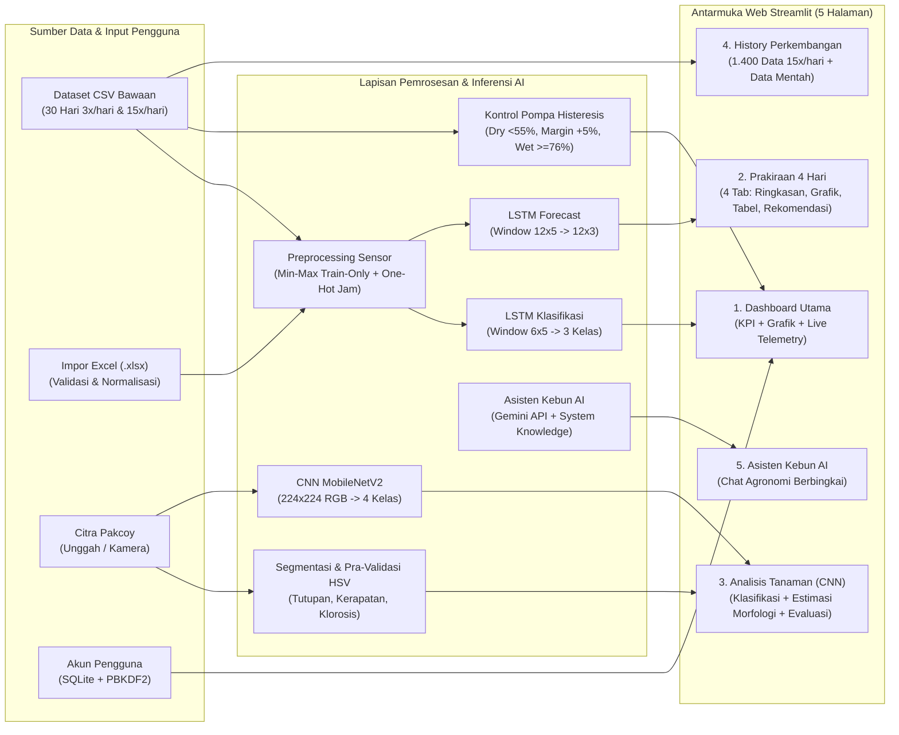

# Catatan Teknis & Dokumentasi Pra-Jurnal Ilmiah — Smart Farming Pakcoy

Dokumen ini merangkum arsitektur sistem, alur data, spesifikasi dataset, konfigurasi dan hyperparameter model, metrik evaluasi aktual yang dapat direproduksi, keterbatasan metodologis, serta saran pengembangan lanjutan dari repositori **Smart Farming Pakcoy**. Seluruh angka pada dokumen ini dihitung langsung dari kode, dataset, dan artefak model aktual di repositori ini.

---

## 1. Arsitektur Sistem

Aplikasi **Smart Farming Pakcoy** dibangun menggunakan **Python 3.11+**, **Streamlit**, **TensorFlow / Keras (`2.21.0`)**, **Plotly**, **Pandas/NumPy**, **Pillow**, **SQLite**, dan **Google GenAI SDK** (`google-genai`).

### Pemetaan Modul Kode
| Modul | Tanggung Jawab Utama |
| :--- | :--- |
| `app.py` | Entry point Streamlit, gerbang autentikasi, navigasi 5 menu sidebar, impor Excel ter-cache, pemuatan model AI (`@st.cache_resource`), dan perenderan seluruh halaman. |
| `utils.py` | Konstanta agronomi (`DRY_LIMIT=55%`, `WET_LIMIT=76%`, `TEMP_OPT=22–28°C`, `MATURITY_THRESHOLDS=[66.5, 89.0]`), validasi/normalisasi Excel (`normalize_dataset`), ekstraksi fitur LSTM (`make_features`), konversi tabel prakiraan (`forecast_table`), logika pompa histeresis (`pump_decision`), analisis warna HSV (`green_analysis`), pra-validasi citra daun (`validate_plant_image`), dan indeks kesiapan panen (`readiness_index`). |
| `charts.py` | Pembangkit grafik interaktif Plotly (donut kondisi tanah, bar distribusi fase, kurva pertumbuhan/kematangan, grafik live telemetry, tren & prakiraan 4 hari dengan zona ideal, grafik kematangan bertingkat, confusion matrix, dan profil 15 jam harian). |
| `ui.py` | Sistem desain tema hijau botani (CSS terisolasi & responsif), kartu KPI, konsol telemetri live, kartu prakiraan 4 hari, kartu rekomendasi antisipasi, estimasi morfologi daun heuristik, dan narasi perawatan tanaman. |
| `auth.py` | Autentikasi pengguna berbasis SQLite lokal (`PBKDF2-HMAC-SHA256`, 100.000 iterasi + salt 16 byte acak, perbandingan constant-time `hmac.compare_digest`), dukungan kredensial admin via `st.secrets`/env, rate limiting login (`5` percobaan gagal / jeda `60` detik), dan pembersihan sesi saat logout. |
| `ai_assistant.py` | Antarmuka chat konsultasi agronomi & sistem berbasis Google Gemini (`google-genai`), fallback model otomatis (`gemini-2.5-flash` → `gemini-2.5-flash-lite`), redaksi API key dari log, dan basis pengetahuan sistem. |

---

## 2. Alur Data & Pemrosesan

### 2.1 Pipeline Data Sensor (LSTM)
1. **Sumber & Penyelarasan Siklus 30 Hari:** Data 40 hari (`3.600` baris / `30` siklus × `120` pembacaan pada `data_training.csv` historis dan `120` baris pada `data_asli.csv`) dikonversi ke siklus budidaya pakcoy **30 hari** menggunakan pemetaan **per hari utuh** (`d_src = round((d_new - 1) * 39 / 29) + 1`, 1-ke-1 unik untuk `d_new = 1..30`) sehingga ketiga sesi pengukuran harian (`08:00`, `12:00`, `16:00`) tetap utuh dan pola diurnal suhu/kelembapan terjaga.
2. **Pembagian Data Bebas Kebocoran (*No Data Leakage*):** Pembagian `train` / `val` / `test` dilakukan pada tingkat **siklus (`Cycle_ID`)**, bukan acak per baris:
   - **Train:** 21 siklus (`Cycle_ID`: 1, 4, 6, 7, 8, 10, 11, 13, 16–27, 30) = `1.890` baris (`70,0%`).
   - **Validation:** 4 siklus (`Cycle_ID`: 3, 12, 15, 29) = `360` baris (`13,3%`).
   - **Test (Uji Simulasi):** 5 siklus (`Cycle_ID`: 2, 5, 9, 14, 28) = `450` baris (`16,7%`).
   - **Uji Eksternal (Data Asli 30 Hari):** 1 siklus terpisah (`data_asli_30hari.csv`) = `90` baris.
3. **Normalisasi Min-Max (*Train-Only*):** Nilai minimum dan maksimum dihitung **hanya dari split `train`**:
   - Kelembapan Tanah: `min = 43,0%`, `max = 83,0%`.
   - Suhu Udara: `min = 22,1°C`, `max = 32,9°C`.
   - Fitur waktu (`08:00`, `12:00`, `16:00`) direpresentasikan sebagai vektor *one-hot* 3 dimensi.
   - Kolom `Day` dan `Time_Index` **sengaja tidak dimasukkan sebagai fitur input** agar model belajar dari sinyal sensor dan jam pengukuran, bukan menghafal indeks hari.
4. **Sliding Window Per Siklus:** Jendela sekuens hanya dibentuk di dalam satu `Cycle_ID` yang sama (tidak pernah melintasi batas antar-siklus):
   - **Klasifikasi Fase (`W_CLS = 6`):** 6 pembacaan terakhir (`2` hari) → kelas fase pada langkah terakhir (`1.785` train, `340` val, `425` test, `85` data asli).
   - **Prakiraan 4 Hari (`W_IN = 12`, `H_OUT = 12`):** 12 pembacaan terakhir (`4` hari) → 12 pembacaan berikutnya (`4` hari) untuk 3 target: kelembapan (skala 0–1), suhu (skala 0–1), dan tingkat kematangan (`maturity / 100`) (`1.407` train, `268` val, `335` test, `67` data asli).
5. **Penentuan Fase dari Kematangan Prakiraan:** Tingkat kematangan hasil prakiraan dipetakan ke 3 kelas pertumbuhan memakai ambang `MATURITY_THRESHOLDS = [66.5, 89.0]`:
   - `< 66,5%` → **Masa Pertumbuhan** (`masa_pertumbuhan`)
   - `66,5% – < 89,0%` → **Mendekati Panen** (`mendekati_panen`)
   - `≥ 89,0%` → **Siap Panen** (`siap_panen`)

### 2.2 Pipeline Citra Tanaman (CNN & Segmentasi HSV)
1. **Validasi & Pra-pemrosesan Unggahan:** File gambar dibatasi maksimal `10 MB`, resolusi piksel dibatasi maksimal `40.000.000 px`, koreksi orientasi EXIF (`ImageOps.exif_transpose`), konversi ke `RGB`, dan ubah ukuran ke `224 × 224` piksel (`float32`, rentang `0–255`; lapisan `Rescaling(1/127.5, offset=-1)` tertanam di dalam model).
2. **Segmentasi Warna HSV & Pra-Validasi Daun:** Konversi RGB → HSV (`max_side=640 px`) dengan rentang mask klorofil & daun menguning `((H ∈ [48, 125], S ≥ 50, V ≥ 38) ∪ (H ∈ [38, 48), S ≥ 70, V ≥ 50))` pada skala HSV 0–255 Pillow. Pra-validasi (`validate_plant_image`) menolak objek non-tanaman bila tutupan hijau `< 3,5%` atau pola bercak terlalu tersebar. **Probabilitas softmax mentah CNN tetap ditampilkan apa adanya** tanpa modifikasi.
3. **Indeks Kesiapan Panen:** Dihitung dari vektor probabilitas softmax CNN dengan bobot: `bukan_pakcoy = 0,0`, `masa_pertumbuhan = 0,0`, `mendekati_panen = 0,5`, `siap_panen = 1,0` (dikalikan 100%; bernilai `0%` jika kelas teratas adalah `bukan_pakcoy`).

---

## 3. Spesifikasi Dataset Aktual

| Dataset | Lokasi File | Baris × Kolom | Rentang Waktu & Frekuensi | Ringkasan Statistik Numerik | Distribusi Kelas / Kondisi |
| :--- | :--- | :--- | :--- | :--- | :--- |
| **Dataset Latih/Val/Uji LSTM (30 Hari)** | `data/data_training_30hari.csv` | `2.700 × 12` | 30 siklus × Hari 1–30, `3×/hari` (`08:00`, `12:00`, `16:00`) | • Kelembapan: `43,0–83,0%` (mean `59,51 ± 8,38%`) • Suhu: `22,1–32,9°C` (mean `27,32 ± 2,10°C`) • Pola suhu harian: `08:00 = 25,00°C`, `12:00 = 29,44°C`, `16:00 = 27,50°C` • Kematangan: `5,0–100,0%` (mean `53,01 ± 29,59%`) | • Fase: `masa_pertumbuhan` `1.641` (60,8%), `mendekati_panen` `612` (22,7%), `siap_panen` `447` (16,6%) • Kondisi: `Optimal` `1.626`, `Dry` `974`, `Wet` `100` |
| **Dataset Uji Lapangan (30 Hari)** | `data/data_asli_30hari.csv` | `90 × 10` | 1 siklus × Hari 1–30, `3×/hari` (`08:00`, `12:00`, `16:00`) | • Kelembapan: `50,0–78,0%` (mean `59,50 ± 8,15%`) • Suhu: `24,5–30,8°C` (mean `27,46 ± 1,94°C`) • Pola suhu harian: `08:00 = 25,16°C`, `12:00 = 29,58°C`, `16:00 = 27,65°C` • Kematangan: `5,0–100,0%` (mean `62,48 ± 31,00%`) | • Fase: `masa_pertumbuhan` `45`, `mendekati_panen` `12`, `siap_panen` `33` • Kondisi: `Optimal` `83`, `Dry` `4`, `Wet` `3` |
| **Riwayat Resolusi Tinggi** | `data/history_perkembangan_pakcoy_1400.csv` | `1.400 × 16` | 4 siklus (`Siklus 1–3` penuh 450 baris + `Siklus 4` 50 baris), `15×/hari` (`06:00–20:00`) | • Kelembapan: `49,0–81,0%` (mean `66,85 ± 5,77%`) • Suhu: `22,6–32,3°C` (mean `27,11 ± 2,32°C`) • Kematangan: `5,0–100,0%` (mean `48,42 ± 29,31%`) | • Fase: `Fase Awal` `500`, `Fase Vegetatif` `450`, `Mendekati Panen` `225`, `Siap Panen` `225` • Kondisi: `Optimal` `1.318`, `Wet` `55`, `Dry` `27` |
| **Dataset Asli Mentah (Sumber Excel)** | `data/dataset_asli_mentah.csv` & `dataset asli/new Dataset_Pakcoy.xlsx` | `1.140 × 8` | Hari `1–380` (`DAP 10–389`), `3×/hari` (`08:00`, `12:00`, `16:00`) | • Kelembapan: `50,0–78,0%` (mean `51,31 ± 3,85%`) • Suhu: `24,5–30,8°C` (mean `26,78 ± 1,79°C`) • Kematangan: `32,0–100,0%` (mean `65,51 ± 19,65%`) | • `Harvest Ready`: `1.065` (`93,4%`), `Initial`: `30`, `Vegetative`: `30`, `Pre-Harvest`: `15` • Catatan anomali: `Dry` tercatat di `63–66%`, `Optimal` mencakup `50–75%` |
| **Dataset Citra CNN (Uji)** | `models/config_cnn.json` (data latih di Google Drive Colab) | `26` gambar uji (split `70/15/15` setelah deduplikasi MD5) | Resolusi input `224 × 224` RGB | 4 kelas: `bukan_pakcoy`, `masa_pertumbuhan`, `mendekati_panen`, `siap_panen` | Support uji: `bukan_pakcoy` `8`, `masa_pertumbuhan` `6`, `mendekati_panen` `5`, `siap_panen` `7` |

**Catatan Korelasi Data Sensor 30 Hari:**
- `data_training_30hari.csv`: $r(\text{Day}, \text{Maturity}) = +0{,}996$, $r(\text{Moisture}, \text{Maturity}) = -0{,}923$.
- `data_asli_30hari.csv`: $r(\text{Day}, \text{Maturity}) = +0{,}980$, $r(\text{Moisture}, \text{Maturity}) = -0{,}970$.

---

## 4. Konfigurasi & Hyperparameter Model

### 4.1 Model LSTM Klasifikasi (`models/model_lstm_klasifikasi.keras`)
- **Arsitektur:** `Input(6, 5)` → `LSTM(64, return_sequences=True)` → `Dropout(0.3)` → `LSTM(32)` → `Dense(32, activation='relu')` → `Dropout(0.2)` → `Dense(3, activation='softmax')`.
- **Jumlah Parameter:** `31.491` (seluruhnya trainable).
- **Hyperparameter Training:** Optimizer `Adam(lr=1e-3)`, loss `sparse_categorical_crossentropy`, `batch_size=64`, maks `100` epoch, `seed=42`, `class_weight` seimbang (`{0: 0.568, 1: 1.368, 2: 1.964}`), `EarlyStopping(monitor='val_loss', patience=12, restore_best_weights=True)`, `ReduceLROnPlateau(factor=0.5, patience=5)`.
- **Konvergensi:** Berhenti pada epoch ke-`25` dengan `best val_loss = 0,2869`.

### 4.2 Model LSTM Forecast 4 Hari (`models/model_lstm_forecast.keras`)
- **Arsitektur:** `Input(12, 5)` → `LSTM(96, return_sequences=True)` → `Dropout(0.2)` → `LSTM(48)` → `Dense(96, activation='relu')` → `Dense(36)` → `Reshape((12, 3))`.
- **Jumlah Parameter:** `75.204` (seluruhnya trainable).
- **Hyperparameter Training:** Optimizer `Adam(lr=1e-3)`, loss `mse`, `batch_size=64`, maks `150` epoch, `seed=42`, `EarlyStopping(monitor='val_loss', patience=15, restore_best_weights=True)`, `ReduceLROnPlateau(factor=0.5, patience=6)`.
- **Konvergensi:** Berhenti pada epoch ke-`41` dengan `best val_loss = 0,002806`.
- **Cadangan Versi Sebelumnya:** Model LSTM 40 hari versi awal tetap diarsipkan di `models/backup_40hari/`.

### 4.3 Model CNN Klasifikasi Citra (`models/model_cnn.keras`)
- **Arsitektur:** `Input(224, 224, 3)` → `Augmentasi` (`RandomFlip`, `RandomRotation(0.08)`, `RandomZoom(0.15)`, `RandomTranslation(0.08)`, `RandomContrast(0.2)`, `RandomBrightness(0.2)`) → `Rescaling(1/127.5, offset=-1)` → `MobileNetV2(weights='imagenet', include_top=False)` → `GlobalAveragePooling2D` → `Dropout(0.3)` → `Dense(4, activation='softmax')`.
- **Jumlah Parameter:** `2.263.108` (`1.668.484` trainable setelah fine-tuning 40 lapisan atas dengan `BatchNormalization` dibekukan; `594.624` non-trainable).
- **Hyperparameter Training (2 Tahap):**
  - Tahap 1 (Feature Extraction): `Adam(lr=1e-3)`, maks `25` epoch, `batch_size=16`, `class_weight` balanced, `EarlyStopping(patience=6)`, `ReduceLROnPlateau(factor=0.5, patience=3)`.
  - Tahap 2 (Fine-Tuning 40 layer teratas): `Adam(lr=1e-5)`, maks `25` epoch, `EarlyStopping(patience=6)`.

---

## 5. Metrik Evaluasi Aktual (Reproducible)

### 5.1 Evaluasi LSTM Forecast 4 Hari (12 Langkah ke Depan)

#### A. Set Uji Simulasi 30 Hari (`5` siklus tak terlihat, `n = 335` jendela = `4.020` titik prediksi per variabel)
| Variabel Target | Model | MAE | RMSE | MAPE (%) | $R^2$ |
| :--- | :--- | :---: | :---: | :---: | :---: |
| **Kelembapan Tanah (%)** | **LSTM Forecast (30 hari)** | **1,634** | **2,117** | **2,82%** | **0,8904** |
| Kelembapan Tanah (%) | Baseline Seasonal 24 Jam | 2,795 | 3,493 | 4,90% | 0,7016 |
| **Suhu Udara (°C)** | **LSTM Forecast (30 hari)** | **0,754** | **0,929** | **2,89%** | **0,7856** |
| Suhu Udara (°C) | Baseline Seasonal 24 Jam | 0,735 | 0,978 | 2,78% | 0,7625 |
| **Tingkat Kematangan (%)** | **LSTM Forecast (30 hari)** | **2,070** | **2,649** | **4,29%** | **0,9866** |

#### B. Set Uji Data Asli 30 Hari (`1` siklus lapangan, `n = 67` jendela = `804` titik prediksi per variabel)
| Variabel Target | Model | MAE | RMSE | MAPE (%) | $R^2$ |
| :--- | :--- | :---: | :---: | :---: | :---: |
| **Kelembapan Tanah (%)** | **LSTM Forecast (30 hari)** | **0,661** | **0,813** | **1,18%** | **0,9823** |
| Kelembapan Tanah (%) | Baseline Seasonal 24 Jam | 2,100 | 2,582 | 3,63% | 0,8218 |
| **Suhu Udara (°C)** | **LSTM Forecast (30 hari)** | **0,130** | **0,165** | **0,48%** | **0,9923** |
| Suhu Udara (°C) | Baseline Seasonal 24 Jam | 0,177 | 0,219 | 0,65% | 0,9864 |
| **Tingkat Kematangan (%)** | **LSTM Forecast (30 hari)** | **12,007** | **12,956** | **17,85%** | **0,6802** |

> [!NOTE]
> **Dampak Penyelarasan Pola Diurnal 30 Hari:** Sebelum penyelarasan (ketika model LSTM 40 hari dievaluasi pada data 30 hari hasil resampling datar yang mengacak fase jam), $R^2$ suhu bernilai negatif (`-1,2763` pada uji simulasi dan `-1,6458` pada data asli, MAE `1,97°C`). Setelah resampling diperbaiki per hari utuh dan model dilatih ulang dengan arsitektur identik, $R^2$ suhu meningkat menjadi **`+0,7856`** (uji simulasi, MAE `0,75°C`) dan **`+0,9923`** (data asli, MAE `0,13°C`).

### 5.2 Evaluasi LSTM Klasifikasi Fase Pertumbuhan

| Set Evaluasi | Jumlah Jendela (`n`) | Akurasi | Macro Precision | Macro Recall | Macro F1 | Weighted F1 |
| :--- | :---: | :---: | :---: | :---: | :---: | :---: |
| **Uji Simulasi (5 siklus)** | 425 | **84,71%** | 78,00% | 82,66% | **79,43%** | 85,12% |
| **Data Asli (1 siklus)** | 85 | **72,94%** | 66,43% | 60,86% | **61,22%** | 73,59% |

**Rincian Per Kelas — Uji Simulasi (`n = 425`):**
| Kelas | Precision | Recall | F1-Score | Support | Confusion Matrix (Baris = Aktual, Kolom = Prediksi) |
| :--- | :---: | :---: | :---: | :---: | :--- |
| `masa_pertumbuhan` | 1,000 | 0,898 | 0,946 | 254 | `[228, 26, 0]` |
| `mendekati_panen` | 0,670 | 0,635 | 0,652 | 96 | `[0, 61, 35]` |
| `siap_panen` | 0,670 | 0,947 | 0,785 | 75 | `[0, 4, 71]` |

*(Tidak ada kesalahan ekstrem antara `masa_pertumbuhan` dan `siap_panen`: sel `[0, 2]` dan `[2, 0]` bernilai `0`.)*

**Rincian Per Kelas — Data Asli 30 Hari (`n = 85`):**
| Kelas | Precision | Recall | F1-Score | Support | Confusion Matrix (Baris = Aktual, Kolom = Prediksi) |
| :--- | :---: | :---: | :---: | :---: | :--- |
| `masa_pertumbuhan` | 0,816 | 1,000 | 0,899 | 40 | `[40, 0, 0]` |
| `mendekati_panen` | 0,176 | 0,250 | 0,207 | 12 | `[9, 3, 0]` |
| `siap_panen` | 1,000 | 0,576 | 0,731 | 33 | `[0, 14, 19]` |

### 5.3 Evaluasi CNN Klasifikasi Citra (`models/config_cnn.json`, `n = 26` gambar uji)

| Kelas | Precision | Recall | F1-Score | Support | Confusion Matrix (Baris = Aktual, Kolom = Prediksi) |
| :--- | :---: | :---: | :---: | :---: | :--- |
| `bukan_pakcoy` | 1,000 | 0,875 | 0,933 | 8 | `[7, 0, 1, 0]` |
| `masa_pertumbuhan` | 1,000 | 1,000 | 1,000 | 6 | `[0, 6, 0, 0]` |
| `mendekati_panen` | 0,667 | 0,800 | 0,727 | 5 | `[0, 0, 4, 1]` |
| `siap_panen` | 0,857 | 0,857 | 0,857 | 7 | `[0, 0, 1, 6]` |
| **Keseluruhan** | **Macro: 88,10%** | **Macro: 88,30%** | **Macro: 87,94%** | **26** | **Akurasi Uji: 88,46% (`23/26` benar)** |

---

## 6. Keterbatasan Sistem (Untuk Bagian *Limitations* di Jurnal)

1. **Simulasi Telemetri & Kontrol Pompa:** Fitur *Live Telemetry* dan kontrol pompa histeresis memutar ulang data siklus tersimpan (simulasi perangkat lunak), bukan pembacaan waktu-nyata dari mikrokontroler IoT (mis. ESP32) dan relai pompa fisik.
2. **Ketergantungan LSTM pada Tren Kelembapan Data Simulasi:** Pada `data_training_30hari.csv`, kelembapan tanah berkorelasi negatif sangat kuat dengan kematangan (`r = -0,923`). Karena fase `mendekati_panen` merupakan masa transisi singkat dengan sedikit sampel (`12` jendela pada data asli), recall kelas `mendekati_panen` pada data asli baru mencapai `25,0%` (`3/12`) dan MAE kematangan data asli `12,01%` (vs `2,07%` pada uji simulasi).
3. **Ukuran Dataset Citra Uji CNN Terbatas:** Evaluasi CNN baru menggunakan `26` gambar uji (`5–8` gambar per kelas), sehingga setiap satu kesalahan klasifikasi menggeser akurasi sebesar `3,85%`. Dataset citra mentah tidak disimpan di repositori publik.
4. **Estimasi Morfologi & Proksi SPAD Non-Alat:** Pada mode otomatis, estimasi panjang/lebar/luas daun (`cm`, `cm²`) dan diameter tajuk dihitung secara heuristik dari rentang fase prediksi CNN dan proporsi tutupan hijau kanopi; pengukuran fisik aktual memerlukan kalibrasi skala (`px/cm`) bersama objek referensi. Demikian pula, nilai SPAD adalah proksi visual berbasis saturasi warna HSV, bukan hasil pembacaan alat klorofil meter SPAD-502 terkalibrasi.
5. **Keterpisahan Sumber Multimodal:** Data sensor (LSTM) dan foto tanaman (CNN) berasal dari pengumpulan terpisah dan tidak berasal dari tanaman fisik yang identik pada momen waktu yang sama.
6. **Persistensi Database Akun di Cloud:** Penyimpanan akun memakai SQLite lokal (`data/users.db`). Pada lingkungan container *ephemeral* seperti Streamlit Community Cloud, file SQLite akan diinisialisasi ulang saat container di-restart.

---

## 7. Saran Pengembangan Lanjutan (*Future Work*)

1. **Integrasi Perangkat Keras IoT:** Menghubungkan aplikasi ke node sensor lapangan (ESP32 + sensor kelembapan tanah kapasitif + SHT31/DHT22 + modul relai pompa) melalui MQTT atau REST API dengan database deret waktu (InfluxDB/PostgreSQL/Supabase).
2. **Pengumpulan Dataset Lapangan Multimodal Berpasangan:** Mengumpulkan minimal `10–15` siklus budidaya lapangan nyata lengkap dengan pencatatan foto top-down harian berjarak tetap + objek referensi kalibrasi (mis. kartu ArUco/kotak 5×5 cm) dan pengukuran SPAD-502 aktual untuk regresi klorofil terkalibrasi.
3. **Perluasan & Validasi Silang Dataset Citra:** Menambah jumlah citra pakcoy per kelas (target ≥ 200 gambar/kelas dengan variasi pencahayaan dan sudut) serta menerapkan *stratified k-fold cross-validation* dan evaluasi *out-of-distribution*.
4. **Benchmarking Model Pembanding:** Membandingkan LSTM dengan arsitektur deret waktu lain (GRU, 1D-CNN, Temporal Fusion Transformer, atau XGBoost berbasis fitur lag) serta membandingkan MobileNetV2 dengan EfficientNetV2/ConvNeXt-Tiny untuk analisis akurasi vs latensi inferensi.
5. **Pengayaan Fitur Input Prediksi Kematangan:** Menambahkan fitur agronomi tambahan (intensitas cahaya/PAR, EC/TDS nutrisi, akumulasi *Growing Degree Days*/GDD) agar estimasi kematangan tidak terlalu bergantung pada tren kelembapan tanah semata.
